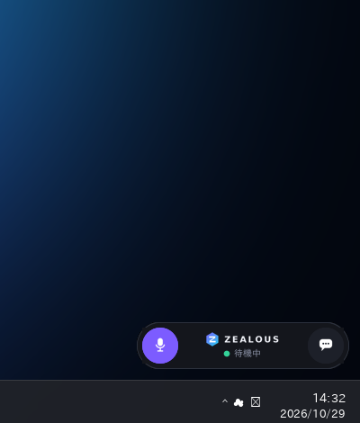
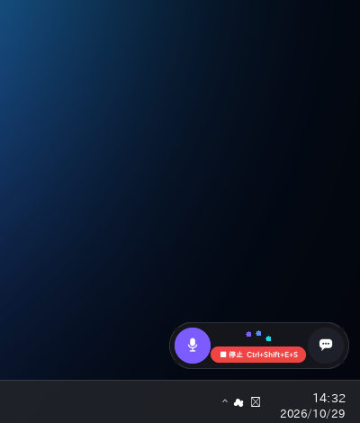
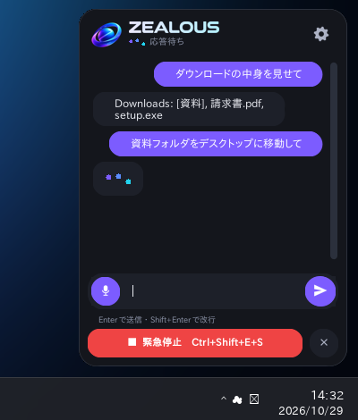

# Zealous（ゼラス）— デスクトップ常駐型 AI PCエージェント

| 待機 | 応答待ち（停止ボタン表示） | 会話パネル（応答待ち） |
|---|---|---|
|  |  |  |

## インストール（Windows 11）
1. 配信用リポジトリ [zealous-releases](https://github.com/hiirocreate/zealous-releases/releases/latest) から **`ZealousSetup.exe`** をダウンロードして実行
2. 初回起動時のセットアップ画面で「準備を開始」を押す
   - AIエンジン（Ollama）・AIモデル・音声合成（VOICEVOX エンジン）・音声認識（Whisper）を自動でダウンロードして準備します（合計 約1.5GB、初回のみ）
   - 容量を抑えるため、必要なものだけを取り出します
     - VOICEVOX: エンジン本体と**選んだ声のモデルだけ**（全部入り約1.9GB → 約0.3GB）。声は ⚙ →「声・音声」→「声を選ぶ」（または「声を変えたい」と話しかける）でキャラ一覧を開き、試聴して選ぶと、その声のモデルだけ後からダウンロードし、使わなくなったモデルは削除します
     - Ollama: NVIDIA の GPU が無いPCでは GPU 用ライブラリを省略（約2.1GB → 約0.1GB）
   - Python・Ollama・VOICEVOX を別途インストールする必要はありません（Python は Zealous.exe に同梱）
   - すでに Ollama / VOICEVOX を起動している場合はそれを使います
3. 以後はデスクトップ・スタートメニューの **Zealous** から起動。Ollama と VOICEVOX は Zealous が裏で自動起動・終了します
4. 設定は本体の **⚙** から。AIモデルを変えるときは、ダウンロードサイズ・必要メモリ・注意点を確認画面で表示し、同意すると裏でダウンロードします
   - Bluetooth操作を使う場合は「管理者として実行」

## アップデート
新しい版が出ると、待機表示の会話ボタンに水色の印が付き、会話パネルに「今すぐアップデート」が表示されます。押すだけで裏でダウンロード・入れ替え・再起動まで行います（設定・AIモデルはそのまま）。
⚙ の「更新を確認」で手動確認もできます。起動時の自動確認は ⚙ でオン/オフ可能です。
> 更新の確認は GitHub Releases の最新版を見ます。配布元（⚙ の「配布元」）は**公開リポジトリ**である必要があります。

## アンインストール
Windows の「設定 > アプリ > インストールされているアプリ」→ Zealous →「アンインストール」（⚙ の「アンインストール」からも可）。
ダウンロードした部品と設定も消すかは確認画面で選べます。

## 保存場所
| 内容 | 場所 |
|---|---|
| 本体 | `%LOCALAPPDATA%\Programs\Zealous` |
| Ollama・AIモデル・VOICEVOX・Whisper | `%LOCALAPPDATA%\Zealous` |
| 設定 | `%APPDATA%\Zealous\settings.json` |

## 開発者向け
- ソースから実行: `pip install -r requirements.txt` → `python zealous.pyw`
- インストーラーは GitHub Actions（`.github/workflows/build.yml`）が PyInstaller + Inno Setup で自動作成
- リリース手順: `v1.1.0` のようなタグを push するだけ。バージョン番号はタグから自動設定され、配信用リポジトリの Releases に公開されて各PCに更新が届きます
  - 初回のみ、このリポジトリの Settings > Secrets and variables > Actions に、変数 `RELEASE_REPO`（例: `hiirocreate/zealous-releases`）と秘密 `RELEASE_TOKEN`（配信用リポジトリへの書き込み権限付きトークン）を登録

## 構成
| ファイル | 役割 |
|---|---|
| `app.py` | 常駐UI（待機は横長楕円: マイク / ロゴ・状態 / 会話ボタン。右下最前面・ドラッグ移動可） |
| `theme.py` / `icons.py` | 配色・フォント / ロゴ・アイコン描画 |
| `stopper.py` | 緊急停止ショートカット Ctrl+Shift+E+S |
| `agent_worker.py` | 推論・PC操作を別プロセスで実行。緊急停止でKill→再起動 |
| `llm.py` | Ollama Tool Call 判定（上限 `MAX_TOOL_STEPS`） |
| `tools.py` | 検索まとめ / アプリ起動 / ブラウザ / ファイル・フォルダ（開く・一覧・作成・名前変更・移動・コピー・ごみ箱へ削除） / 音量・ロック・シャットダウン / Bluetooth |
| `voice.py` | 録音（トランシーバー/トグル/常時待ち受け）＋Faster-Whisper |
| `tts.py` | VOICEVOX 非同期再生 |
| `wakeword.py` | 「ウェイク、<AI名>」検出 |
| `settings_window.py` | 設定の管理画面（⚙ボタン） |
| `zealous.pyw` | 起動口（初回セットアップ → 本体、`--uninstall` で後片付け） |
| `setup_wizard.py` | 初回セットアップ画面 |
| `updater.py` / `version.py` | 更新の確認・適用 / バージョン番号 |
| `websearch.py` / `apps.py` | Web・画像検索と本文の取り出し / アプリを名前で探して起動 |
| `threads.py` / `single_instance.py` / `winutil.py` | チャットのスレッド保存 / 二重起動の防止 / なめらかな外枠・影とマルチモニター（Windows） |
| `voice_picker.py` / `ime.py` | 声を選ぶ画面（試聴・ダウンロード） / 日本語入力の変換中の文字を入力欄に表示 |
| `gallery.py` | 画像一覧・拡大表示ウィンドウ |
| `models.py` | AIモデルの選択肢とサイズ確認（変更時に必ずサイズと注意を表示） |
| `remotezip.py` / `voicevox.py` | 配布 zip から必要なファイルだけ取り出す / VOICEVOX の声を選んで後から取得 |
| `runtime.py` | Ollama・VOICEVOX・Whisper の自動ダウンロードと裏での起動/停止 |
| `packaging/installer.iss` | インストーラー（Inno Setup）定義 |
| `services.py` | Ollama/VOICEVOX 接続確認・モデル取得 |
| `shortcut.py` | 自動起動・起動コマンド |
| `config.py` | 設定の既定値と `%APPDATA%\Zealous\settings.json` への保存 |

## できること（話しかけ方の例）
| 例 | 動き |
|---|---|
| 「ポメラニアンの性格を調べて」 | Webを検索し、上位3ページを読んで要約。会話パネルに要約・関連画像・出典リンク（クリックでブラウザ表示）、要約を読み上げ |
| 「リンゴの写真探しておいて」 | 画像を検索し、画像一覧ウィンドウを表示（クリックで拡大・元のページを開く・ピクチャ\Zealous に保存）。会話パネルにもサムネイル |
| 「ブラウザで天気を検索して」 | ブラウザで検索結果ページを開く |
| 「Excelを起動して」「メモ帳を開いて」 | スタートメニューのアプリ（ストアアプリ含む）を名前で探して起動 |
| 「デスクトップにメモを作って」「ダウンロードの中身を見せて」 | ファイル・フォルダ操作 |
| 「音量を30にして」「画面をロックして」 | PC基本操作 |

## 画面の操作
- 待機表示はドラッグで**どのモニターにも**移動可（デュアルスクリーン対応、位置は保存）。会話ボタンでパネルがなめらかに広がる
- 会話パネルは**端をドラッグして大きさを自由に変更**、□ボタン（または見出しのダブルクリック）で全画面
- **チャットはスレッド（話題ごと）で保存**。パネルが広いと左に一覧、狭いと ☰ で一覧を開く。＋で新しいチャット
- Zealous は1つだけ起動（ショートカットを何度押しても増えず、今のウィジェットが前面に出る）

## 会話の流れ
1. 話す: **話すキー（既定: 右Ctrl）を押しながら話す**／マイクボタン／ウェイクワード（ONのとき「ウェイク、Zealous、〜」）
2. 離すと文字起こし → AI が必要な操作を選んで実行 → 返事は**書けた分から表示し、一文できるごとに読み上げ**（「〜を調べて」「〜の写真を探して」「〜を起動して」は AI の判断を待たずに即実行）
3. 続けて話すときも同じ操作。直前の4往復を覚えているので「それをもっと詳しく」のような続きの話ができます（10分話しかけなければ忘れる。⚙ で変更可）
- 返事の読み上げ中に話し始めると、読み上げは止まります

## 動作
- トリガー: 「ウェイク、Zealous（ゼラス）、〜して」。AI名・別表記・ウェイク語は⚙設定画面で変更可。
- 設定は保存時に即反映（推論プロセスを再起動）。Whisper関連のみアプリ再起動後に反映。
- ウェイクON: 常時待ち受けを開始し、先頭にウェイクワードがある音声のみ実行。マイクボタンで話すときはウェイクワード不要（言っても取り除いて実行）。
- 待機表示はドラッグで移動可（位置は保存）。会話パネルは常駐位置から画面の内側へ展開。
- チャット欄: Enter で送信 / Shift+Enter で改行。
- フォルダ操作は ⚙ の「権限」で許可/禁止を切替。Windows・Program Files・ドライブ直下・ホーム直下・アプリ本体は常に保護。削除はごみ箱へ移動。
- 応答待ちの間はドットが波打つローディング表示。
- 緊急停止ボタンは操作中のみ表示。Ctrl+Shift+E+S は常に有効。
- 緊急停止: 推論/操作プロセスを強制終了、音声再生・録音・認識待ちも破棄。
- ⚙「お試しモード」ONで関数を実行せず呼び出し内容のみ表示（判定確認用）。
- シャットダウンは30秒猶予（「シャットダウンを取り消して」で中止）。

## テスト
`python -m pytest tests`
